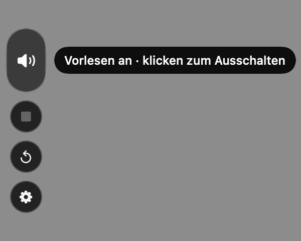

# Agent Speak

Liest nach jeder Antwort von **Claude Code** eine kurze Zusammenfassung vor. Braucht Claude eine Entscheidung von dir, hörst du zusätzlich den Hintergrund und Claudes Empfehlung für den nächsten Schritt.

Gesteuert wird das über ein kleines Overlay am Bildschirmrand (ähnlich wie bei Wispr Flow). Es sitzt immer auf dem Bildschirm, auf dem gerade der Mauszeiger ist. Fährst du mit der Maus darüber, klappt es auf:



- 🔊 Vorlesen an/aus
- ⏹ Laufende Ansage stoppen
- ↺ Letzte Ansage wiederholen
- ⚙︎ Einstellungen (ElevenLabs-Key, Stimme, Modell, Sprechtempo, Systemstimme, Overlay-Position, Hook)
- ✍︎ Prompt der Zusammenfassung einsehen und anpassen, Länge der Ansage wählen (kurz, normal, ausführlich)

Du kannst das Overlay greifen und an eine andere Stelle ziehen. Lässt du los, rastet es am nächsten Rand ein, links oder rechts. Die Höhe merkt es sich.

Solange zusammengefasst wird, pulsiert der Griff. Während der Ansage zeigt er Schallwellen. Dieselben Funktionen gibt es zusätzlich über das Lautsprecher-Symbol in der Menüleiste.

## Installation (für Kolleg:innen)

1. Lade `AgentSpeak-x.y.z.zip`, entpacke die Datei und ziehe `AgentSpeak.app` nach **Programme**.
2. Beim ersten Start meldet macOS, dass die App von einem nicht verifizierten Entwickler stammt, denn sie ist nicht notarisiert. Du hast zwei Möglichkeiten:
   - Rechtsklick auf die App → **Öffnen** → **Öffnen**
   - oder im Terminal:
     ```bash
     xattr -dr com.apple.quarantine /Applications/AgentSpeak.app
     ```
3. Die Einstellungen öffnen sich. Klicke auf **Hook installieren**. Damit trägt die App einen `Stop`-Hook in `~/.claude/settings.json` ein. Andere Hooks bleiben erhalten, vorher wird eine Sicherung angelegt (`settings.json.bak-agent-speak`).
4. Optional für ElevenLabs: API-Key einfügen → **Speichern** → Stimme wählen. Ohne Key wird die kostenlose macOS-Systemstimme verwendet.
5. Optional: **Beim Anmelden starten** aktivieren.
6. Laufende Claude-Code-Sessions übernehmen den Hook erst nach einem Neustart.

### Voraussetzungen

- macOS 13 oder neuer (Apple Silicon oder Intel)
- [Claude Code](https://claude.com/claude-code) mit angemeldetem Abo. Die Zusammenfassung läuft über `claude -p --model haiku`.
- `jq`, ab macOS 15 bereits vorinstalliert, sonst `brew install jq`

In den Einstellungen unter „Claude-Code-Hook“ siehst du, ob alles gefunden wurde.

## So funktioniert es

```
Claude Code ──Stop-Hook──▶ ~/.claude/hooks/speak-summary/speak-summary.sh
                              │  1. letzte Antwort lesen
                              │  2. claude -p (Haiku) → kurzer Vorlesetext
                              │  3. ElevenLabs (oder `say`) → abspielen
                              ▼
                       Statusdateien: muted · summarizing · player.pid · last.txt
                              ▲
Agent Speak (Overlay) ────────┘  liest den Status, schaltet muted, schreibt config
```

- Das Hook-Skript läuft auch ohne geöffnete App. Die App dient nur zur Bedienung und Einrichtung.
- Das Skript läuft im Hintergrund, Claude Code wird also nicht ausgebremst. Kommt eine neue Antwort, bricht die laufende Ansage ab.
- Der ElevenLabs-Key liegt nur im macOS-Schlüsselbund (Dienst `elevenlabs-api-key`), nie in einer Datei. Lesen dürfen ihn die App und `/usr/bin/security`, also das Hook-Skript.
- Konfiguration: `~/.claude/hooks/speak-summary/config`. Gepflegt wird sie von der App, du kannst sie aber auch von Hand bearbeiten.
- Eigener Prompt: `~/.claude/hooks/speak-summary/prompt.txt`. Die Datei gibt es nur, wenn du den Prompt änderst; ohne sie gilt der Standard aus dem Skript (`speak-summary.sh --default-prompt`). `{{LAENGE}}` wird durch die gewählte Länge ersetzt.
- Wird eine neue App-Version gestartet, aktualisiert sie das installierte Hook-Skript automatisch.

Kommandozeile, falls gewünscht:

```bash
~/.claude/hooks/speak-summary/speak-summary.sh --test "Beliebiger Text"
~/.claude/hooks/speak-summary/speak-summary.sh --mute | --unmute | --stop | --replay | --voices
```

## Entwicklung

```bash
swift build && .build/debug/AgentSpeak          # Debug starten
scripts/build-app.sh                             # dist/AgentSpeak.app + ZIP (universal, ad-hoc signiert)
.build/debug/AgentSpeak --snapshot /tmp/shots    # Overlay + Einstellungen als PNG rendern
```

Code:

- `hook/speak-summary.sh` enthält das Hook-Skript. Es wird ins App-Bundle kopiert und von dort installiert.
- `Sources/AgentSpeak/Overlay.swift` enthält das Overlay-Panel. Es folgt dem Mauszeiger über alle Bildschirme und klappt bei Hover auf.
- `Sources/AgentSpeak/Settings.swift` enthält das Einstellungsfenster.
- `Sources/AgentSpeak/Support.swift` enthält Pfade, Konfiguration, Schlüsselbund, die ElevenLabs-API und den Hook-Installer.
- `Sources/AgentSpeak/AppState.swift` liest die Statusdateien und stellt die Aktionen bereit.

Version steht in `VERSION`.

### Ohne Gatekeeper-Warnung verteilen

Mit einem Apple-Developer-Account (Developer ID) lässt sich die App signieren und notarisieren. Dann entfällt Schritt 2 der Installation:

```bash
SIGN_IDENTITY="Developer ID Application: Firma (TEAMID)" scripts/build-app.sh
xcrun notarytool submit dist/AgentSpeak-*.zip --keychain-profile <profil> --wait
xcrun stapler staple dist/AgentSpeak.app
```
